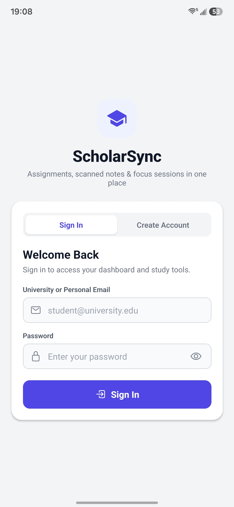
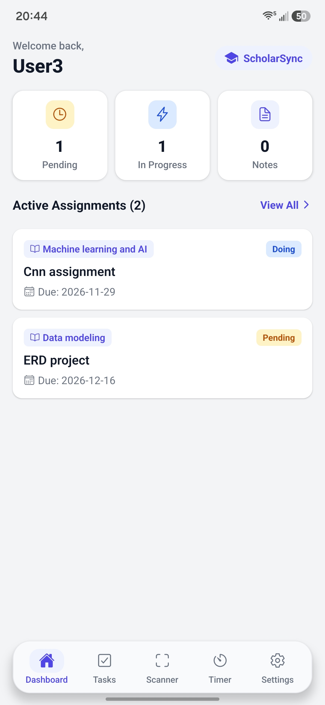
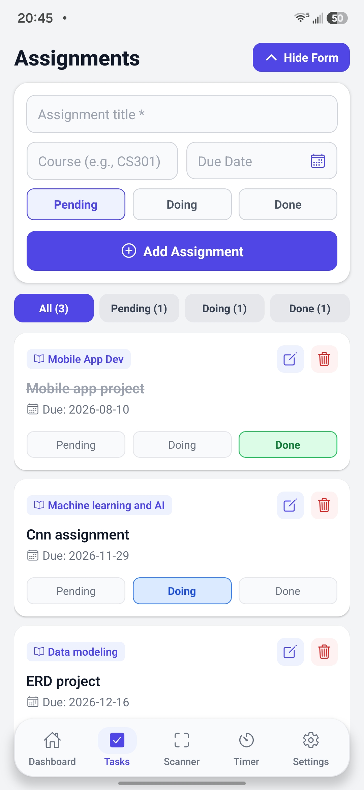
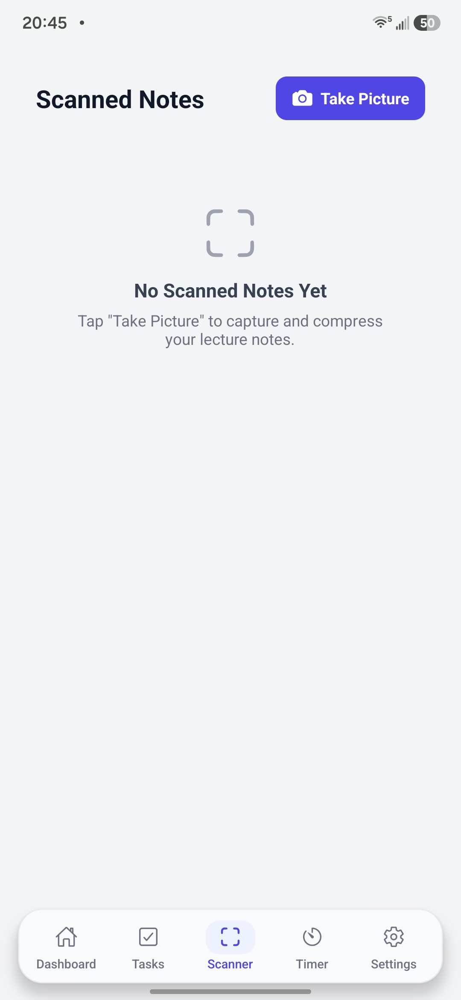
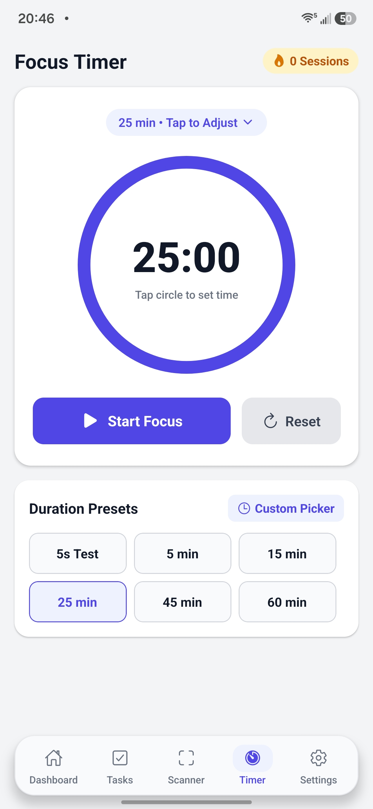
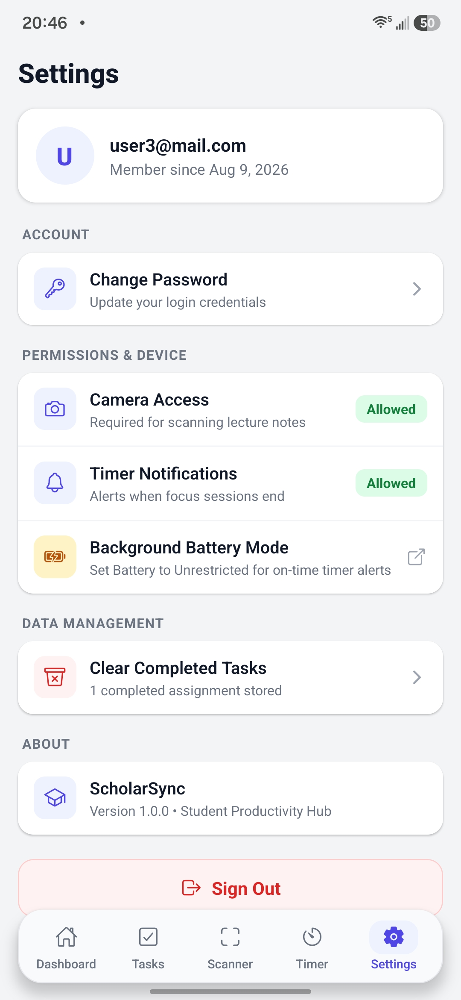

# ScholarSync

An all-in-one, cross-platform mobile productivity hub engineered specifically for university students using **React Native**, **Expo**, and **Supabase**. ScholarSync reduces digital fragmentation and app fatigue by unifying assignment tracking, lecture note digitization, and Pomodoro focus timing into a single client-server application.

---

## Screenshots

<table>
  <tbody>
    <!-- Row 1 Headers -->
    <tr>
      <td width="33%" align="center"><strong>Login</strong></td>
      <td width="33%" align="center"><strong>Dashboard</strong></td>
      <td width="33%" align="center"><strong>Assignment Tracker</strong></td>
    </tr>
    <!-- Row 1 Screenshots -->
    <tr>
      <td align="center"></td>
      <td align="center"></td>
      <td align="center"></td>
    </tr>
    <!-- Row 2 Headers -->
    <tr>
      <td align="center"><strong>Document Scanner</strong></td>
      <td align="center"><strong>Pomodoro Timer</strong></td>
      <td align="center"><strong>Settings</strong></td>
    </tr>
    <!-- Row 2 Screenshots -->
    <tr>
      <td align="center"></td>
      <td align="center"></td>
      <td align="center"></td>
    </tr>
  </tbody>
</table>

---

## Key Features

- **Authentication & Auth-Guarded Routing:** Token-based JWT login and signup powered by Supabase Auth, automatically routing unauthenticated users to the login screen and signed-in users to the main tab navigator.

- **At-a-Glance Workload Dashboard:** Displays a personalized student greeting, live summary counters for `Pending`, `In Progress`, and total `Notes`, and an active assignments feed filtered to `pending` and `doing` coursework ordered by deadline.

- **Smart Assignment Tracker:** Full CRUD task management featuring a collapsible creation form, course tagging (e.g., `CS301`), native due-date selection (`@react-native-community/datetimepicker`), one-tap status chips (`Pending`, `Doing`, `Done`), an edit modal, and status filter tabs with live task counts.

- **Study Document Scanner:** Captures physical lecture notes and whiteboard sketches via `expo-camera`, prompts for a note title, automatically resizes (max width `1200px`) and compresses (`72%` JPEG quality) images via `expo-image-manipulator`, encodes them to Base64 for upload to Supabase Storage, and downloads/caches images locally for full-screen viewing.

- **Pomodoro Focus Timer:** Built-in study timer utilizing `expo-notifications` to schedule local system-level push alerts when focus sessions or breaks end—even when the app is minimized or running in the background.

- **Account & Device Settings:** Includes account profile details, an in-app password change modal, shortcuts to check runtime camera/notification permissions and device battery optimization settings, a bulk cleanup option for completed tasks, and sign-out functionality.

- **Floating Tab Bar Navigation:** Custom rounded floating card bottom navigation bar built with Expo Router and `react-native-safe-area-context`.

---

## Tech Stack & Architecture

ScholarSync follows a **Client-Server** architecture pairing a cross-platform mobile frontend with **Supabase** as an integrated Backend-as-a-Service (BaaS):

- **Framework & Navigation:** React Native, Expo SDK 57, Expo Router (file-based routing), TypeScript

- **UI & Styling:** Custom mobile-first card design system, `@expo/vector-icons` (`Ionicons`), `react-native-safe-area-context`, `@react-native-community/datetimepicker`

- **Device Hardware & Native APIs:**
- `expo-camera` — Runtime permission handling and document photo capture

- `expo-image-manipulator` — Client-side image resizing and JPEG compression

- `expo-file-system` — Modern `File` and `Paths` APIs for Base64 encoding and local file caching

- `expo-notifications` — Background local push notifications for study intervals

- **Backend & Security:** Supabase (PostgreSQL relational database, JWT Authentication, Storage buckets, and Row Level Security policies)

---

## Project Structure

```text
├── app/
│   ├── (auth)/
│   │   └── login.tsx          # Email/password login & signup with SafeArea + KeyboardAvoidingView
│   └── (tabs)/
│       ├── _layout.tsx        # Floating card bottom tab navigator
│       ├── dashboard.tsx      # Workload stats & active ('pending' / 'doing') assignments
│       ├── tasks.tsx          # Collapsible form, status filters, native date picker & CRUD
│       ├── scanner.tsx        # Camera capture, image compression, cloud upload & viewer
│       ├── timer.tsx          # Pomodoro focus timer with local push notifications
│       └── settings.tsx       # Profile, change password, permissions & completed task cleanup
├── services/
│   └── supabase.ts            # Supabase client initialization
└── package.json

```

---

## Database Schema & Security (Supabase)

All database tables and storage buckets enforce **Row Level Security (RLS)** using `auth.uid() = user_id` so users can only read, insert, update, or delete their own records and files.

### Tables & Storage

1. **`tasks` Table:** `id` (`uuid`), `user_id` (`uuid`), `title` (`text`), `course_name` (`text`, nullable), `deadline` (`text`, nullable), `status` (`'pending' | 'doing' | 'done'`).

2. **`notes` Table & `notes` Storage Bucket:** Stores digitized note metadata in PostgreSQL and compressed `.jpg` files under `${user.id}/${timestamp}.jpg` in Supabase Storage.

```sql
-- Create the notes table
CREATE TABLE IF NOT EXISTS notes (
  id uuid DEFAULT gen_random_uuid() PRIMARY KEY,
  user_id uuid REFERENCES auth.users(id) ON DELETE CASCADE NOT NULL,
  image_name text NOT NULL,
  image_url text NOT NULL,
  created_at timestamptz DEFAULT now() NOT NULL
);

ALTER TABLE notes ENABLE ROW LEVEL SECURITY;

CREATE POLICY "Users can view their own notes"
  ON notes FOR SELECT USING (auth.uid() = user_id);

CREATE POLICY "Users can insert their own notes"
  ON notes FOR INSERT WITH CHECK (auth.uid() = user_id);

CREATE POLICY "Users can update their own notes"
  ON notes FOR UPDATE USING (auth.uid() = user_id) WITH CHECK (auth.uid() = user_id);

CREATE POLICY "Users can delete their own notes"
  ON notes FOR DELETE USING (auth.uid() = user_id);

```

3. Ensure to create a `notes` bucket in **Supabase Storage** with `SELECT`, `INSERT`, `UPDATE`, and `DELETE` RLS policies on `storage.objects`.

---

## Getting Started

### Prerequisites

- Node.js (LTS) and npm/yarn
- A configured [Supabase](https://supabase.com) project with Email Auth enabled, `tasks` and `notes` tables, and a `notes` storage bucket

- Android Studio (Android SDK) or Xcode (macOS) to compile a local development build

### Installation & Setup

1. **Clone the repository and install dependencies:**

```bash
git clone https://github.com/MevinRamjeet/ScholarSync.git
cd ScholarSync
npm install
```

2. **Configure Supabase:**
   Open `services/supabase.ts` and add Supabase project URL and anonymous public key.

3. **Run with a Custom Development Build:**
   Because ScholarSync integrates native modules (`expo-notifications`, `expo-camera`, `expo-image-manipulator`, and `@react-native-community/datetimepicker`), it requires a **custom development build** rather than standard Expo Go:

```bash
# Compile and run on a connected Android device or emulator
npx expo run:android

# Or compile and run on iOS (macOS only)
npx expo run:ios
```

> Verified on physical Android hardware (Samsung Galaxy A11 and Samsung Galaxy A54) as well as iOS simulators.

---

## Future Improvements

- **Modular Architecture Refactoring:** Extracting Supabase queries into `services/`, state logic into custom `hooks/` (`useTasks`, `useNotes`), and modals/cards into reusable `components/`.

- **Light & Dark Mode:** Implementing a `ThemeContext` using `useColorScheme()` with semantic color tokens and an appearance switcher in Settings.

- **Optical Character Recognition (OCR):** Extracting searchable, editable text directly from scanned lecture notes and whiteboard photos.

- **Assignment-Linked Notes & Study Analytics:** Linking scanned notes directly to specific tasks via a `task_id` foreign key and logging completed Pomodoro sessions to track daily study minutes.
